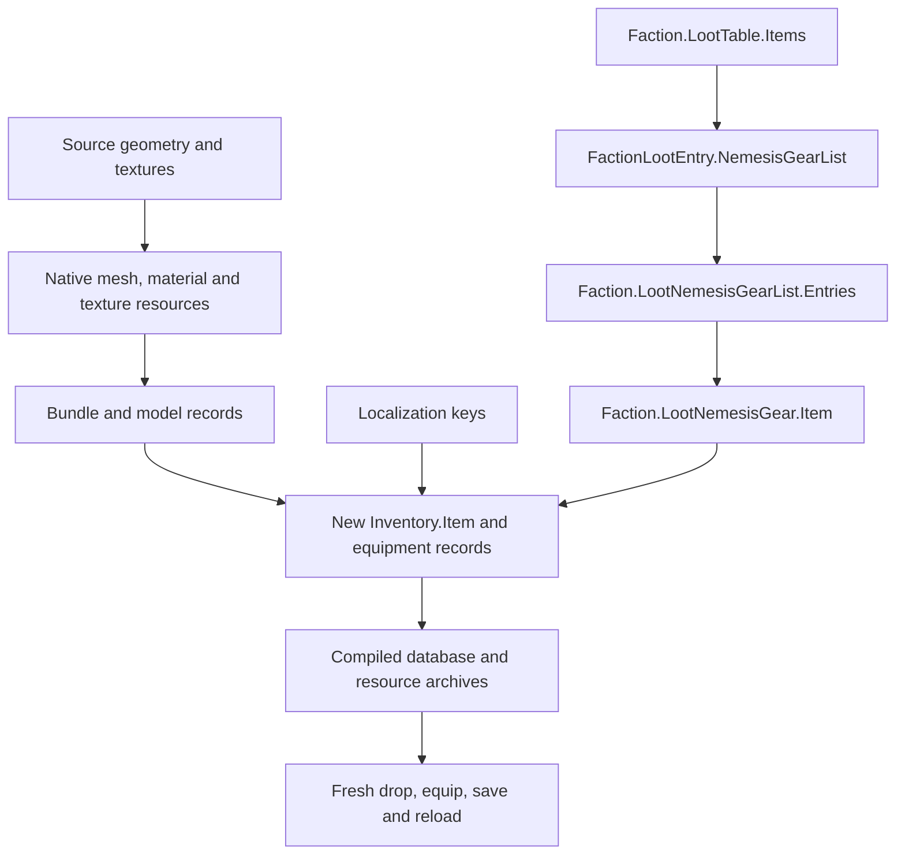

# Adding weapons to Shadow of War

A technical guide to bringing a custom weapon into **Middle-earth: Shadow of War (PC)** as a separate inventory item and making it available through the game's loot system.

The source can be your own Blender model, a GLB/FBX/OBJ asset, or a model extracted with its materials and skeleton from another game. Once the source is prepared, the integration work is the same: native resources, an inventory record graph, localization, loot registration, packaging and an in-game test.

**Start with [Adding an inventory item](docs/ADDING_ITEMS.md), then [Adding it to loot](docs/LOOT_POOLS.md).** These are the main parts of this guide.

## What has to connect



A converted mesh can render correctly while remaining completely unreachable through loot. A new inventory record can also exist without its resources being loaded. Both graphs have to be connected.

## Read in order

| Step | Guide | Result |
| --- | --- | --- |
| 1 | [Tools and evidence](docs/TOOLING_AND_EVIDENCE.md) | Know which tools are public and which integration capabilities you still need. |
| 2 | [Asset pipeline](docs/ASSET_PIPELINE.md) | Prepare geometry, materials, texture streams and local bundle dependencies. |
| 3 | [Adding an inventory item](docs/ADDING_ITEMS.md) | Give the weapon its own identity, model references, stats and name. |
| 4 | [Loot pools](docs/LOOT_POOLS.md) | Connect the item to the intended reward routes without accidentally replacing existing lists. |
| 5 | [Animations and slots](docs/ANIMATION_AND_SLOTS.md) | Match the native slot, attachment and combat behavior. |
| 6 | [Packaging and testing](docs/PACKAGING_AND_TESTING.md) | Build against the current database, resolve references, package dependencies and verify an actual drop. |

## First integration target

Use one custom sword with native sword behavior for your first addition. Give it a private resource namespace and a new item identity. Keep the original donor item available. Start with one controlled loot route, then expand distribution after a fresh reward, equip/unequip and save/reload test pass.

Adding a sword-shaped item to an existing slot does **not** create a new gameplay weapon class. A new class also needs its own input, behavior, animations and possibly UI support. A model replacement alone does not supply those systems.

## Tools you can download

- [Monstey Mesh Publisher](https://github.com/LordMonstey/Monstey-Mesh-Publisher): Blender import/export for native models and custom mesh conversion. The [v0.1.1 release](https://github.com/LordMonstey/Monstey-Mesh-Publisher/releases/tag/v0.1.1) provides the installable add-on.
- [SoW ANIX format](https://github.com/LordMonstey/sow-anix-format): animation format documentation and a Python reference decoder.

Neither tool adds inventory records or loot entries. **This repository is a guide, not a bundled GADB compiler or archive installer.** The integration tools used to establish the workflow are identified in [Tools and evidence](docs/TOOLING_AND_EVIDENCE.md), with their availability made explicit. The record examples explain the required edits; they are not a patch you can drop into the game.

## Included examples

- [Annotated record graph](examples/weapon-records.annotated.json): a small, named weapon addition with the relationships explained in the item guide.
- [Weighted pools](examples/loot-pools.json) and [loot_odds.py](tools/loot_odds.py): a runnable illustration of how a group weight differs from each member's share.

From this directory, with Python 3.10 or newer:

```powershell
python tools/loot_odds.py examples/loot-pools.json
python -m unittest discover -s tests -v
```

The example gives the imported group 10% of a single, fixed-weight draw. Three equal members each receive about 3.33%. Adding more members to that group divides its share; it does not increase the group's weight.

**These are conditional example probabilities, not a prediction of SoW's long-term drops.** Native eligibility predicates, reward routes, rarity and adaptive weight trackers change the selection context. The calculator neither reads nor edits a game database.

## Scope and evidence

The documentation comes from native resource inspection, database compilation and practical integration work. Each chapter distinguishes a format or reference check from an in-game result. A successful large batch build is not evidence that every weapon, reward route and animation has been tested in game.

No game models, textures, extracted databases, archives, private character models or save files are included. The JSON examples use synthetic item identities. Contributions should include a reproducible case and state whether the result was observed in game or only verified offline; see [Contributing](CONTRIBUTING.md).

## License

The documentation and original example code in this repository are available under the [MIT license](LICENSE). This license covers the contents of this repository, not assets or tools obtained elsewhere.
