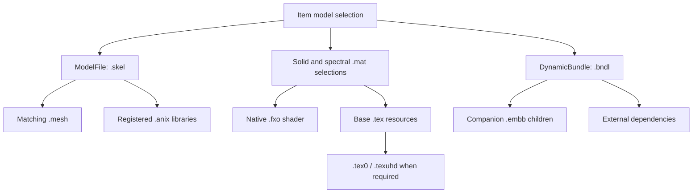

# Preparing a weapon asset

A weapon import has several outputs: native geometry, the matching rig, native materials and textures, a complete resource-loading path, and item data that selects those resources. A `.mesh` export completes only the geometry stage. Start with one weapon and one native target so that placement, shading, loading and equipment behavior can be checked separately.

This guide documents contracts observed in the conversion implementation. The public [Monstey Mesh Publisher](https://github.com/LordMonstey/Monstey-Mesh-Publisher) supplies the Blender mesh workflow. The material, texture, bundle and database builders used to establish the wider pipeline are private project tools and are not distributed here. The sections below explain the required work without presenting those tools as downloadable commands.

## 1. Bring the source into an editable scene

The source can be your own model, a model supplied by another artist, or an asset extracted from a game you can access. Its origin changes the preparation step, but does not change the Shadow of War output contract. Keep original files, provenance, source identifiers and any redistribution requirements with your working project. No source models or game assets are included in this repository.

| Source | Preparation before native conversion |
| --- | --- |
| GLB | Inspect geometry, UVs, images, material regions, transforms and any skin. Embedded images are source inputs, not native game textures. |
| glTF | Keep referenced buffers and images together. Import the complete scene in Blender and prepare it for the publisher's GLB interchange. Missing external data means an incomplete source. |
| FBX | Import with a suitable Blender importer. Check units, axes, armature rest pose, normals and materials, then use the same Blender preparation path. FBX is not a direct native-mesh input to the publisher. |
| OBJ | Check units, winding, normals and UVs. OBJ has no skeletal weights or animation; choose explicit rigid binding or author weights. An MTL file does not become a native `.mat`. |
| Your own Blender asset | Prepare the mesh in the native reference frame, retain editable source work and publish the selected custom geometry. |
| Extracted source format | First use a source-specific decoder or exporter. Preserve material associations, LODs, transforms, skin palettes and inverse binds where available. Extracted geometry does not prove complete textures, effects or animation. |

The publisher's replacement UI imports GLB. Other formats are preparation paths through Blender, not additional formats claimed for its import button. See its [Blender guide](https://github.com/LordMonstey/Monstey-Mesh-Publisher/blob/master/docs/BLENDER.md) for the workflow and the [official glTF specification](https://registry.khronos.org/glTF/specs/2.0/glTF-2.0.html) for the interchange format.

Record what is present. Extracted scenes can contain alternative appearances, helper surfaces, FX geometry or incomplete LODs. Select the intended appearance deliberately rather than combining every primitive that shares a file.

## 2. Choose the native target before fitting

Use a native weapon from the intended equipment and animation route as the template. Retain its exact extracted parent and matching resources. Similar filenames do not prove that direct and embedded variants share the same rig, materials or texture family.

The template determines:

- Native containers, LOD routing and material connections.
- Skeleton hierarchy, bind transforms and Havok bone indices.
- The grip and attachment frame expected by the player.
- The weapon animation and shader contracts the replacement must satisfy.

A rigid sword can use a compatible sword target. A dagger needs a native Dagger target. A bow or crossbow needs its moving weapon rig; renaming a sword mesh does not supply that rig. A flail needs an articulated chain path if its head must move. See [Animation and slots](ANIMATION_AND_SLOTS.md).

Import the extracted `.mesh` and qualified matching `.skel` in **Original**, then inspect the containers and rig. The skeleton file supplies names and hierarchy; the native mesh carries bind and index data needed by the geometry. The right file extensions alone do not establish a matched pair.

## 3. Fit units, axes and the grip

Native geometry uses centimetres and Y-up coordinates. Blender uses a Z-up working frame; the publisher converts the native reference. Its replacement export normally converts GLB metres to native centimetres with output scale 100. Review the scene and exporter settings before adding another scale or rotation.

An extracted source can also require an artistic fitting scale. Do not copy a fitted factor from a different game or weapon family. Measure the source and target and record this asset's transform.

Fit the grip to the native reference rather than centering the bounding box at the origin. Check blade or shaft direction, handle thickness, guard clearance and finger contact. Sword and dagger frames are not interchangeable. A crossbow's stock, string and nock require separate landmarks.

Transform shading data consistently:

- Positions receive the chosen scale, rotation and translation.
- Normals must remain valid under that transform, including nonuniform scale.
- Tangents, bitangents, UV orientation and normal-map convention must agree.
- Reflected transforms and changed winding require explicit review.

Preserve the target's rest rig, inverse binds, hierarchy and socket definitions. Fit the custom geometry to that contract. Editing a shared player socket for one asset can move other weapons using it.

## 4. Choose rigid or skeletal binding

**Rigid binding** assigns the converted part to an explicit native bone. It suits a solid sword, dagger or part that follows one transform. Choose that bone from the actual target; no handle index is universal.

**Skeletal binding** is necessary when parts move relative to one another, including bow limbs and string, crossbow mechanisms and a flail chain. Attach the custom mesh to the native armature and provide deform weights. Attaching an armature alone creates no weights.

The publisher supports imported native indices, explicit name maps and explicit index maps. An index map refers to the exported glTF skin joint table, not Blender vertex-group order or a text dump's bone order.

Native SKEL preorder and Havok palette order can differ. Retain the imported HK metadata or derive a verified mapping. Every positive weight must resolve to an existing target bone, and weights must remain normalized after export. Inspect weight-transfer results around overlapping or nearby surfaces; the nearest donor can be the wrong part.

Keep position, normal, tangent, bitangent, color, UV, blend-index and blend-weight channels. Vertex color can affect the native shader even when Blender's source preview looks unchanged. Do not replace it with an arbitrary constant without checking the shader contract.

## 5. Publish geometry

| Workflow | Appropriate change | Output behavior |
| --- | --- | --- |
| Native editing | Edit an imported native model while retaining topology and container correspondence. | Exports all imported containers through the native path. An unchanged import has a byte-identical round trip. |
| Custom replacement | Replace a selected container with new geometry, including new vertex and face counts. | Uses glTF interchange, retains native skeleton and material bindings, and keeps other template containers. |

For a custom replacement:

1. Import and inspect the original template and matching rig.
2. Import the GLB, or prepare the custom mesh in Blender.
3. Select the target container explicitly.
4. Fit the model and choose rigid or skeletal binding.
5. Review UVs, shading frame, vertex colors and test poses.
6. Run **Preflight** on the current selection.
7. Export to a new `.mesh` filename and keep the JSON report.

For native edits, use **Recalculate tangent frame** after edits that invalidate the previous frame. Custom replacement passes through Blender normals and glTF, so it does not promise bit-exact native normal preservation.

Multiple source materials require a deliberate layout. Map regions to compatible native containers or prepare an atlas and matching native material. The publisher does not automatically create native shaders for each source PBR material.

Validate allocation metadata as well as parsing. Changing submeshes or layouts affects draw and attribute capacity. The established writer recomputes `info + 20` and `info + 40`; retaining counters from a smaller donor can leave insufficient runtime storage. Respect per-draw vertex/face limits, palette limits and the selected shader's stricter requirements. File-format capacity alone does not establish shader capacity.

## 6. Rebuild native materials and textures

Blender PBR materials are source previews. They are not converted automatically to native `.mat`, `.tex`, `.tex0` or `.texuhd` resources. The publisher retains template material bindings, so a valid new mesh can still display the donor material until the material stage is completed.

Start with a native material whose shader and vertex layout fit the intended weapon. Preserve parameter types, flags, order and unrelated properties. Repoint intended texture references to private resources and check the material's shader identifier against the shader it will load. Matching identifiers alone do not prove compatibility with an unrelated shader program or vertex permutation.

| Concern | Required decision or check |
| --- | --- |
| Color space | Separate color/emission sampling from linear data such as normals, roughness, metalness and masks. Retain role-specific native texture metadata. |
| Normal convention | Determine tangent handedness and normal Y direction. Repack components for the native shader consistently with the tangent/bitangent streams. |
| Channel packing | Read the selected shader contract. Generic metallic-roughness data is not automatically a native specular or normal texture. |
| Atlas | Remap UVs and textures together. Preserve regions, provide mip gutters and handle tiled UVs deliberately. |
| Mips | Preserve or produce all required mip coverage and verify extents. A top-level image is not a complete streamed family. |
| Codec | Make the TEXR header, metadata DXGI and DDS format agree. Equal block sizes do not identify a codec. |
| Alpha and effects | Use a compatible opaque, cutout or translucent path. Copying visible FX geometry does not recreate its source controller. |
| Missing maps | Record absent source data and explicit neutral fallbacks. Flat normals or white AO are not recovered authored detail. |

One established `talion_weapon` recipe uses color, packed normal/AO and packed metalness/roughness textures. Its normal texture stores X in G and Y in A, with AO in B; the conversion handles source Y and UV transposition. This is a specific shader recipe, not a universal rule for `_n` or `_s` filenames. Other material variants assign channels differently, including alpha channels that do not represent emission.

Resolve shared shader and texture dependencies beyond the obvious diffuse and normal maps. Solid and spectral appearances each need complete dependencies. A reused spectral shader also retains its reveal, opacity and dissolve behavior.

## 7. Close the resource graph

Model selection, material references and loading resources must agree on exact virtual paths. These are engine resource names, not local filesystem paths.

| Resource | Role in the inspected pipeline |
| --- | --- |
| `.mesh` | MMSH geometry, native bindings, containers and draw data. |
| `.skel` | Model skeleton and animation-library references. The item model points here, with its matching mesh alongside it. |
| `.anix` | Native animation library for its owning weapon or character. |
| `.mat` | Native material and texture/shader references. |
| `.tex` | Base native texture, commonly embedded with its owning bundle. |
| `.tex0`, `.texuhd` | Streaming peers for families using them, with source-specific mip contents. |
| `.embb` | Embedded payloads, names and stored payload lengths. |
| `.bndl` | Dependency names, size hints and native bundle kind, not the payload container. |

Reserve a private namespace for new resources and keep references consistent after renaming. An illustrative model namespace is `characters/modelweapons/player/1h_sword/example_author/example_sword/`, with a corresponding private bundle path. It is not an included asset.

Preserve unrelated BNDL rows and EMBB children. Add dependencies through a qualified writer, then re-read both outputs. EMBB payload lengths must match stored bytes. Added or changed BNDL size hints must describe the effective resource variant the game will load. A larger replacement clip or texture needs its owner's metadata updated.

BNDL and EMBB need not contain identical path sets or equal sizes for every matching name. Dependencies may be external, and native hints can differ from an embedded variant. Preserve untouched values and inspect direct-resource precedence before changing a hint. Do not normalize every row to an embedded file's size.

For streamed textures, preserve base-to-peer and peer-to-base references. Keep `.tex0` and `.texuhd` external unless native evidence demonstrates another contract. Compare overlapping mip blocks and retain the exact parent variant: a similarly named direct texture may have different dimensions or codec. A deliberately authored no-peer texture is a different complete layout, not a streamed family missing its peers.

Dependency closure means every private reference and necessary native dependency resolves through the intended package/load route. Files existing in a work folder do not establish closure. Archive packing, registration and installation require separate compatible tooling; the public mesh publisher performs none of these operations.

## 8. Validate before item integration

Keep source/template hashes, conversion reports, virtual paths, resource sizes and output hashes together. Review:

- Mesh re-read, finite data, indices, allocations and unchanged native bindings.
- Bounds, scale, grip contact and LOD/material routing.
- Weights and representative poses for moving weapons.
- Material/shader compatibility, packed channels, texture metadata, mip extents and peers.
- Complete dependencies, correct modified bundle sizes and preserved unrelated children.

These are offline checks. They do not prove engine loading, UI visibility or combat behavior. Test the integrated asset in game for appearance, equip/unequip, relevant attacks, spectral state, transitions and save/load.

Continue with [Adding items](../docs/ADDING_ITEMS.md) to create an inventory identity selecting the resources, then [Loot pools](LOOT_POOLS.md) to make it eligible for drops. Adding a model, adding an item and admitting that item to loot are separate steps.
